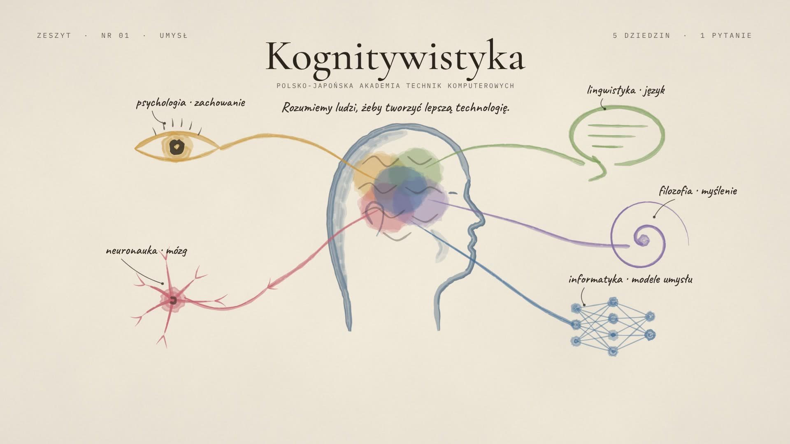
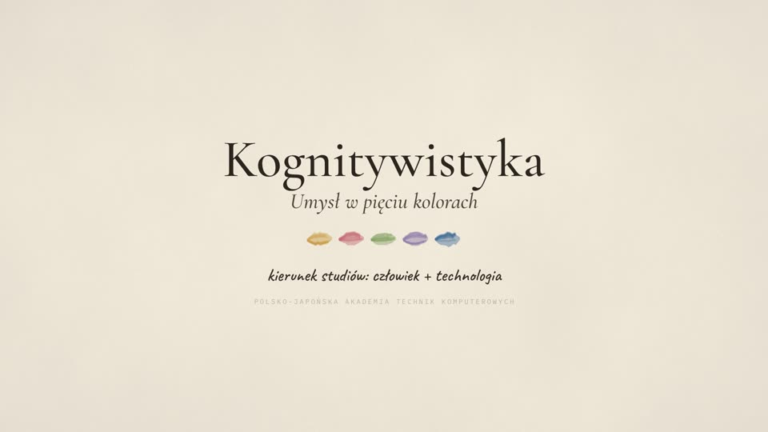
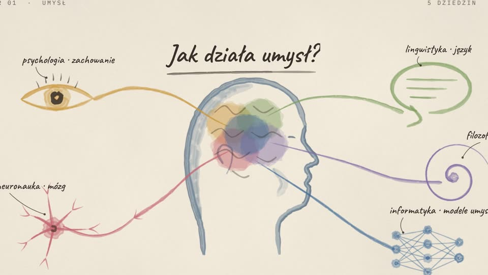
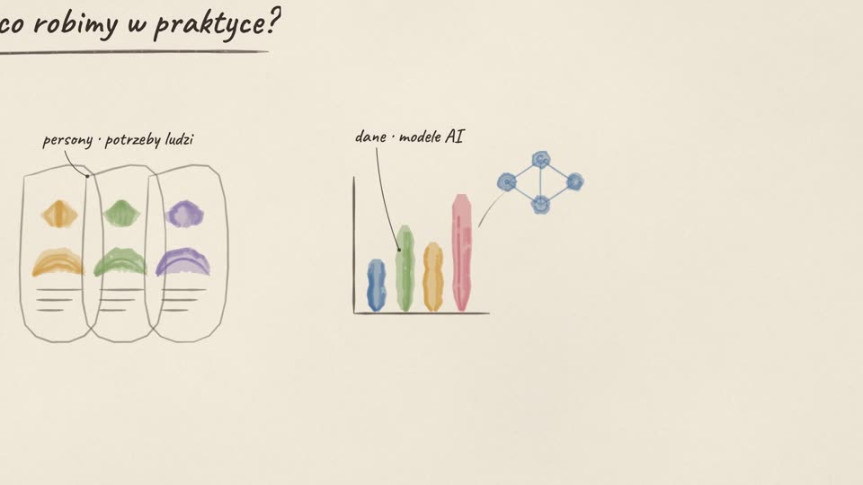

# Umysł w pięciu kolorach: film o kognitywistyce

Krótki film animowany w stylu akwareli, który przedstawia kognitywistykę na PJATK: czym się zajmuje i co robimy w praktyce. Cały obraz jest rysowany kodem, pociągnięcie po pociągnięciu, jak strony w zeszycie przyrodnika.

**Typ:** projekt własny
**Narzędzia:** JavaScript (Canvas 2D), Python (NumPy, SciPy: muzyka i dźwięki syntetyzowane w kodzie), ffmpeg, biblioteka [Lemo-Opuscar](https://github.com/lemomo-ai/lemo-opuscar) (styl Watercolor Brush), lektor: głosy neuronowe Microsoft przez Luvvoice

## Wersje

| Wersja | Plik | Długość |
|---|---|---|
| polski lektor | [film_pl.mp4](film_pl.mp4) | 56 s |
| angielski lektor | [film_en.mp4](film_en.mp4) | 54 s |
| angielski lektor + polskie napisy | [film_en_napisy_pl.mp4](film_en_napisy_pl.mp4) | 68 s |

W każdej wersji tekst na ekranie jest w języku lektora. Napisy są też osobno w pliku [napisy_pl.srt](napisy_pl.srt).

## Przebieg

1. **Tytuł:** „Kognitywistyka · Umysł w pięciu kolorach” i krótkie wyjaśnienie, czym jest kierunek: człowiek + technologia.
2. **Pytanie „Jak działa umysł?”:** maluje się głowa, a wokół niej pięć dziedzin, każda we własnym kolorze: psychologia, neuronauka, lingwistyka, filozofia i informatyka.
3. **Połączenie:** po chwili ciszy kolory spływają do głowy i mieszają się w jeden umysł.
4. **„A co robimy w praktyce?”:** odwraca się strona zeszytu. Pokazuję na niej opaskę mierzącą stres przy lęku społecznym (nawiązanie do projektu [Mankiet komfortu](../../techniczne/wearable-lek-spoleczny/)), persony opisujące potrzeby ludzi (nawiązanie do [person rodziców](../../ux-i-badania/persony-rodzicow/)) oraz analizę danych i modele AI.
5. **Zakończenie:** wracamy na pierwszą stronę z tytułem, hasłem „Rozumiemy ludzi, żeby tworzyć lepszą technologię” i pieczątką PJATK.

| | | |
|---|---|---|
|  |  |  |

## Jak powstał

- Obraz to jedna strona HTML z rysowaniem na Canvas. Każdy element (oko, neuron, dymek, spirala, sieć, opaska, persony, wykres) jest zbudowany z pociągnięć pędzla, które malują się w czasie.
- Kamera (przybliżenia, przejazdy, odwrócenie strony) i moment pojawiania się każdego elementu są wyliczane z długości zdań lektora. Dlatego każda wersja językowa ma własną oś czasu (`timeline_*.json`). W wersji z napisami każde zdanie zostaje na ekranie tak długo, żeby dało się je przeczytać.
- Muzyka (kalimba, dzwonki, tło), dźwięki pędzla, ołówka, kartki i pieczątki są syntetyzowane w Pythonie, bez gotowych sampli.
- Klatki renderuje przeglądarka bez okna (60 fps, 1920×1080), a ffmpeg łączy je z dźwiękiem i wyrównuje głośność.

Źródła są w folderze [zrodla/](zrodla/): `main.js` (animacja), `mix.py` (dźwięk), `timeline.py` (podział nagrań lektora i oś czasu), `build.sh` (cały film jednym poleceniem) i `TREATMENT.md` (scenariusz). Licencje czcionek, lektora i stylu są w [CREDITS](zrodla/CREDITS).
