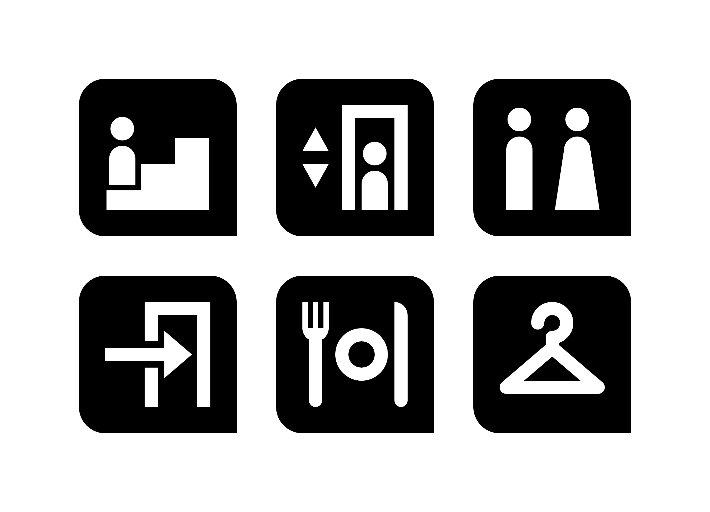

# Znak z geometrii – zestaw piktogramów „Kafel-znacznik”

Zadanie 02 z Adobe Illustratora: zaprojektowanie spójnego zestawu sześciu czarno-białych piktogramów zbudowanych wyłącznie z prostych figur geometrycznych. Celem było przećwiczenie budowania czytelnych znaków z kół, prostokątów i trójkątów, łączenia i odejmowania kształtów (Pathfinder / Shape Builder) oraz edycji punktów ścieżek.

## Piktogramy

Schody · Winda · Toaleta · Wejście · Restauracja · Garderoba

## Koncepcja

Każdy znak to **czarny kafel 240 × 240 px z białym symbolem w negatywie**. Trzy narożniki kafla są zaokrąglone (r = 40), a prawy dolny jest ostry, jak szpic pinezki na mapie: kafel „wskazuje miejsce”. Wspólna gramatyka zestawu:

- siatka 20 px, grubość elementów 20 px,
- człowiek to zawsze ten sam moduł: głowa (koło r = 18) i tułów (prostokąt szer. 40 z półkolistą górą),
- plansza 1080 × 780 px, odstęp między kaflami 60 px, margines 120 px.

## Pliki

| Plik | Opis |
|---|---|
| `plansza_piktogramy.svg` | Plansza z piktogramami (wektor) |
| `plansza_piktogramy.pdf` | Plansza w PDF |
| `podglad_plansza.png` | Podgląd planszy |
| `Przewodnik_Illustrator.md` | Przewodnik krok po kroku: jak zbudować każdy znak w Illustratorze |
| `buduj_piktogramy.jsx` | Skrypt ExtendScript, który buduje planszę w Illustratorze |

## Uruchomienie skryptów

W Illustratorze: **Plik → Skrypty → Inny skrypt…** i wybierz `buduj_piktogramy.jsx`. Skrypt utworzy nowy dokument 1080 × 780 px z gotowymi piktogramami na osobnych warstwach.

---

Projekt indywidualny (zadanie na studiach). Autor: Kacper Książek
