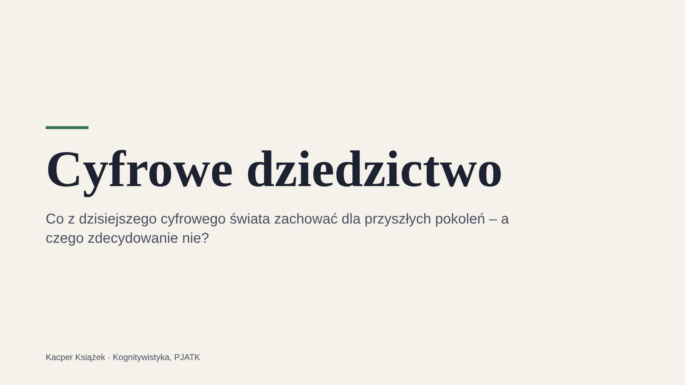

# Cyfrowe dziedzictwo

5-minutowe wystąpienie na zajęcia (kognitywistyka, PJATK). Odpowiada na dwa pytania: co z dzisiejszego cyfrowego świata zachować dla przyszłych pokoleń, a czego zdecydowanie nie przekazywać dalej.

**Typ:** zadanie indywidualne
**Plik:** [cyfrowe-dziedzictwo.pdf](cyfrowe-dziedzictwo.pdf) (10 slajdów)

## Teza
- **Zachować:** otwartą wiedzę (Wikipedia, open access, open source), codzienną kulturę sieci, technologie, które łączą i włączają (np. dostępność).
- **Nie zachowywać jako normy:** projektowania pod uzależnienie, śledzenia i handlu danymi, algorytmów premiujących oburzenie.
- **Puenta:** zachować to, co wspólne, otwarte i ludzkie. To, co traktuje nas jak produkt, zarchiwizować jako przestrogę.
