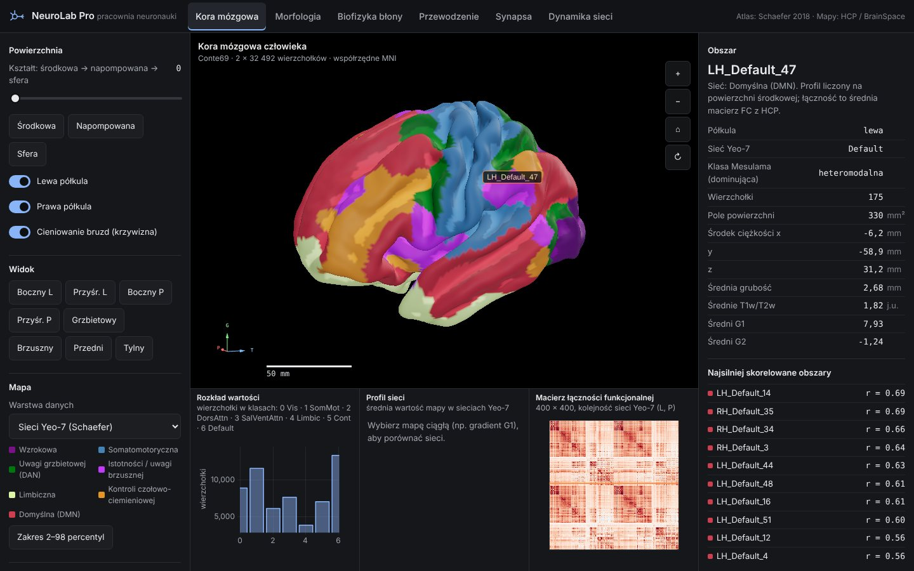
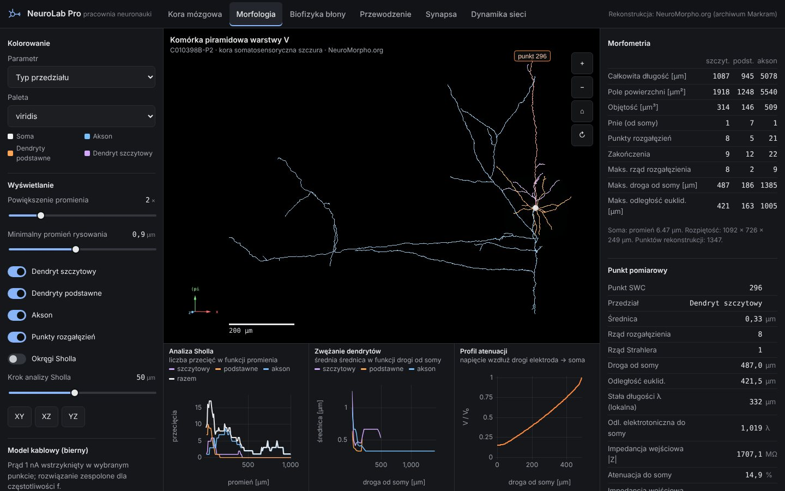
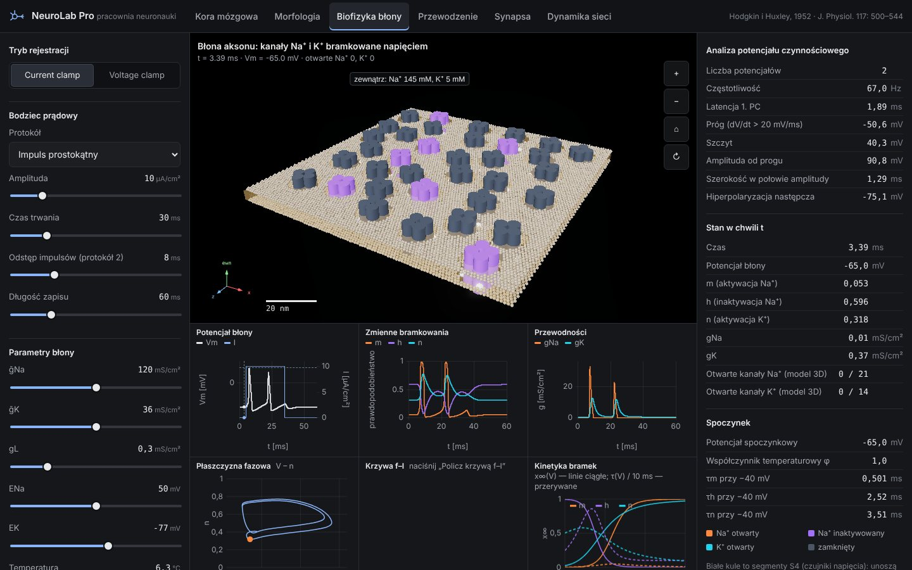
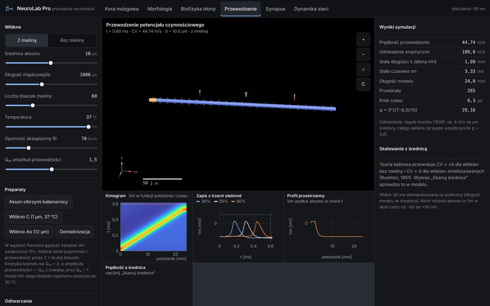
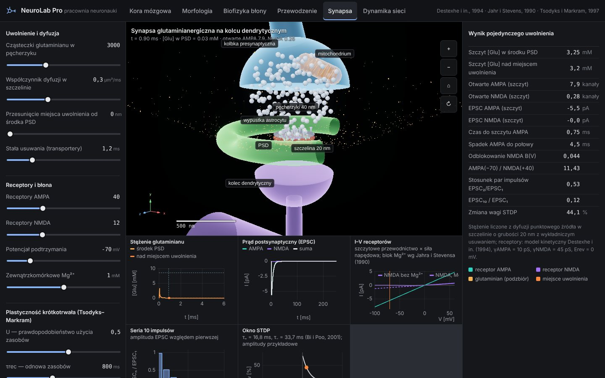
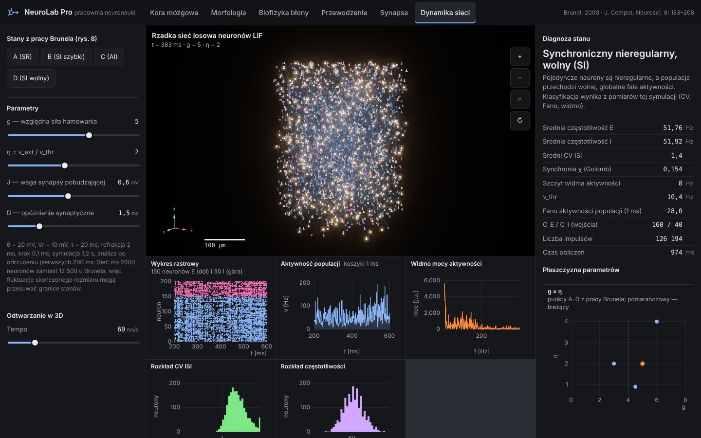

# NeuroLab Pro – pracownia neuronauki obliczeniowej

Interaktywna aplikacja przeglądarkowa do nauki neurobiologii na poziomie akademickim. Prowadzi od pojedynczego kanału jonowego, przez neuron, akson i synapsę, aż do sieci neuronów i kory całego mózgu człowieka. Łączy prawdziwe dane anatomiczne (powierzchnię kory z atlasem, rekonstrukcję neuronu) z modelami biofizycznymi, które liczą się na żywo w przeglądarce.

**Typ:** projekt na przedmiot *Kognitywne przetwarzanie informacji* (kognitywistyka, PJATK), blok neurobiologiczny
**Narzędzia:** JavaScript (ES2020), three.js (WebGL), uPlot, esbuild; Python (NumPy, SciPy, nibabel) do przygotowania danych; Node.js i Playwright (Chrome bez interfejsu) do testów



## Zobacz online
**[arizonu.github.io/portfolio/techniczne/neurolab-pro](https://arizonu.github.io/portfolio/techniczne/neurolab-pro/)**

Działa w przeglądarce z obsługą WebGL, także na telefonie. Lokalnie trzeba ją otworzyć przez serwer HTTP (np. `python3 -m http.server` w tym folderze), bo aplikacja wczytuje dane z plików.

## Cel projektu

Przedmiot *Kognitywne przetwarzanie informacji* pyta, jak układ nerwowy koduje, przesyła i przetwarza informację. Chciałem pokazać tę drogę na kolejnych poziomach organizacji, tak żeby każdą wielkość dało się zmierzyć, a nie tylko obejrzeć na rysunku:

| Poziom | Pytanie | Moduł |
|---|---|---|
| kanał jonowy i błona | skąd bierze się impuls „wszystko albo nic”? | Biofizyka błony |
| akson | jak szybko i jakim kosztem impuls dociera do celu? | Przewodzenie |
| neuron | jak kształt drzewa dendrytycznego zmienia sygnał? | Morfologia neuronu |
| synapsa | jak sygnał elektryczny staje się chemicznym i z powrotem? | Synapsa |
| sieć | jak równowaga pobudzenia i hamowania tworzy kod populacyjny? | Dynamika sieci |
| kora | jak obszary mózgu układają się w sieci i hierarchie? | Kora mózgowa |

Założenia: prawdziwe dane zamiast ilustracji, modele z literatury z podanym źródłem, wszystkie liczby liczone na bieżąco, jednostki i skale (pasek skali, osie, palety kolorów z legendą) widoczne przy każdym widoku.

## Moduły

### 1. Kora mózgowa


- **Dane:** powierzchnia kory Conte69 (2 × 32 492 wierzchołki, współrzędne MNI), atlas Schaefer-400 z podziałem na 7 sieci Yeo, hierarchia Mesulama oraz mapy grupowe z HCP: grubość kory, T1w/T2w (miara mielinizacji), krzywizna, gradienty łączności funkcjonalnej G1 i G2, gradient mikrostruktury MPC.
- **Co można zrobić:** przełączać mapy i palety kolorów (z kontrolą zakresu i legendą), płynnie „napompować” korę do postaci gładkiej i sfery, oglądać widoki boczne, przyśrodkowe, grzbietowe i inne, ciąć mózg płaszczyznami strzałkową, czołową i poziomą.
- **Analiza:** po najechaniu kursorem: współrzędne MNI, nazwa obszaru, sieć, klasa Mesulama i wartości map. Po kliknięciu obszaru: jego pole powierzchni, średnia grubość i mielinizacja, 10 najsilniej skorelowanych obszarów i średnia łączność z każdą siecią. Kora koloruje się wtedy mapą łączności z tym obszarem („seed”). Do tego histogram mapy, profil sieci i macierz łączności 400 × 400, którą też można klikać.
- **Co widać:** gradient G1 ma najniższe średnie wartości w sieci somatomotorycznej (−5,5) i wzrokowej (−2,2), a najwyższe w sieci domyślnej, DMN (6,0). To oś hierarchii przetwarzania od bodźca do myśli abstrakcyjnej (Margulies i in., 2016).

### 2. Morfologia neuronu


- **Dane:** rekonstrukcja komórki piramidowej warstwy V z kory somatosensorycznej szczura (NeuroMorpho.org, archiwum Markram, plik C010398B-P2).
- **Wizualizacja:** drzewo zbudowane z rur o prawdziwych średnicach (z regulacją powiększenia promienia), kolorowane według typu przedziału, rzędu rozgałęzienia, rzędu Strahlera, odległości od somy lub średnicy.
- **Morfometria:** długość, pole powierzchni i objętość osobno dla dendrytu szczytowego, dendrytów podstawnych i aksonu; liczba pni, rozgałęzień i zakończeń; analiza Sholla (liczba przecięć w funkcji promienia) i wykres zwężania się dendrytów.
- **Model kablowy:** klikasz dowolny punkt drzewa i wstrzykujesz tam prąd 1 nA. Program rozwiązuje bierne równanie kablowe na całym drzewie (metoda Hinesa, liczby zespolone dla częstotliwości f) i pokazuje mapę atenuacji napięcia, impedancję wejściową, lokalną stałą długości λ, odległość elektrotoniczną do somy oraz profil spadku napięcia po drodze do somy. Parametry Rm, Ri, Cm i f są na suwakach.
- **Co widać:** sygnał z dalekiego zakończenia dendrytu szczytowego dociera do somy osłabiony do kilkunastu procent, a sygnały szybkie (wyższe f) słabną bardziej. To powód, dla którego położenie synapsy na neuronie ma znaczenie obliczeniowe.

### 3. Biofizyka błony (model Hodgkina–Huxleya)


- **Model:** pełne równania Hodgkina i Huxleya (1952), całkowane metodą Rungego–Kutty 4. rzędu, z temperaturą (Q₁₀ = 3) i farmakologią (blok kanałów Na⁺ tetrodotoksyną, blok kanałów K⁺ tetraetyloamonem).
- **Current clamp:** impuls prostokątny, dwa impulsy (pomiar refrakcji) i rampa. Wykresy: Vm(t), bramki m, h, n, przewodności gNa i gK, płaszczyzna fazowa V–n, krzywa f–I. Automatyczna analiza potencjału: próg, szczyt, amplituda, szerokość w połowie amplitudy, hiperpolaryzacja następcza, latencja i częstotliwość.
- **Voltage clamp:** rodziny prądów INa i IK dla serii skoków napięcia oraz zależność prąd–napięcie, czyli klasyczne doświadczenie Hodgkina i Huxleya.
- **3D:** fragment dwuwarstwy lipidowej z kanałami Na⁺ i K⁺. Stan każdego kanału jest losowany z prawdopodobieństw m³h i n⁴ z symulacji: otwarty, zamknięty lub (dla Na⁺) inaktywowany. Czujniki napięcia S4 unoszą się razem z aktywacją, a przez otwarte kanały płyną jony.

### 4. Przewodzenie w aksonie


- **Model:** wieloprzedziałowy akson z kinetyką HH. Wersja bez mieliny ma kanały na całej długości. Wersja z mieliną ma węzły Ranviera z kanałami i międzywęźla, w których pojemność i przewodność są podzielone przez liczbę blaszek mieliny. Całkowanie: niejawna metoda Eulera (algorytm Thomasa) z wykładniczym krokiem bramek.
- **Wyniki:** kimogram (Vm w funkcji położenia i czasu), zapis z trzech elektrod, profil przestrzenny, zmierzona prędkość przewodzenia oraz skan prędkości dla różnych średnic z dopasowaniem nachylenia w skali log–log.
- **Gotowe preparaty:** akson olbrzymi kałamarnicy, włókno C, włókno Aα i demielinizacja (blok przewodzenia).
- **Co widać:** we włóknach bez mieliny prędkość rośnie jak √d. Skan w modelu daje nachylenie 0,50, dokładnie jak w teorii kablowej (Rushton, 1951). We włóknach zmielinizowanych prędkość rośnie szybciej (nachylenie ok. 0,56 dla 0,5–8 µm), choć teoria przewiduje 1. Powodem jest stała liczba blaszek mieliny i stała długość węzła w modelu. Zbyt cienka mielina zatrzymuje impuls.

### 5. Synapsa glutaminianergiczna


- **3D w skali nanometrów:** kolbka presynaptyczna z pęcherzykami 40 nm, strefa aktywna, mitochondrium z grzebieniami, szczelina 20 nm, gęstość postsynaptyczna (PSD) z receptorami AMPA i NMDA, kolec dendrytyczny i wypustka astrocytu. Animacja pokazuje fuzję pęcherzyka i dyfuzję glutaminianu.
- **Model:** dyfuzja z punktowego źródła w szczelinie z usuwaniem przez transportery, kinetyka receptorów według Destexhe i in. (1994), blok magnezowy NMDA według Jahra i Stevensa (1990). Wyniki: stężenie glutaminianu w czasie, prądy EPSC (AMPA, NMDA, suma), krzywe I–V receptorów i stosunek AMPA/NMDA.
- **Plastyczność:** krótkotrwała w modelu Tsodyksa–Markrama (seria 10 impulsów, stosunek par impulsów, synapsa depresyjna i facylitująca) oraz okno STDP.
- **Co widać:** przesunięcie miejsca uwolnienia o 200 nm od środka PSD zmniejsza szczytową liczbę otwartych receptorów AMPA o ok. jedną trzecią (z 7,9 do 5,2). Pokazuje to, dlaczego ważne jest ustawienie strefy aktywnej naprzeciw PSD. Receptor NMDA przy −70 mV jest zablokowany w ok. 96%, więc działa jak detektor koincydencji.

### 6. Dynamika sieci


- **Model:** rzadka sieć losowa 1600 neuronów pobudzających i 400 hamujących typu „integrate-and-fire” (model A z pracy Brunela, 2000) z opóźnieniem synaptycznym i wejściem Poissona.
- **Analiza:** wykres rastrowy, aktywność populacji, widmo mocy (FFT), rozkłady CV ISI i częstotliwości, współczynnik Fano populacji i synchronia χ. Na podstawie tych pomiarów program rozpoznaje stan sieci: synchroniczny regularny, asynchroniczny nieregularny albo synchroniczny nieregularny.
- **3D:** kolumna 2000 neuronów, które rozbłyskują przy każdym impulsie podczas odtwarzania symulacji.

## Sprawdzenie modeli

| Test | Wynik w aplikacji | Odniesienie |
|---|---|---|
| prędkość w aksonie olbrzymim kałamarnicy (476 µm, 18,5 °C, parametry HH) | 18,5 m/s | 18,8 m/s z obliczeń HH (1952); 21,2 m/s zmierzone |
| próg wyładowań ciągłych modelu HH (6,3 °C) | skok do ok. 46 Hz przy 6,25 µA/cm² | ok. 6,2 µA/cm², pobudliwość typu II |
| blok Mg²⁺ receptora NMDA (1 mM) | 4,4% przewodności przy −70 mV, 98% przy +40 mV | wzór Jahra i Stevensa (1990) |
| włókno C (1 µm, 37 °C) | ok. 1,3 m/s | 0,5–2 m/s in vivo |
| włókno zmielinizowane 10 µm, 37 °C | ok. 45 m/s | reguła Hursha ok. 100 m/s (model zaniża) |
| skalowanie prędkości z średnicą, bez mieliny (0,5–16 µm) | nachylenie log–log 0,50 | 0,5 (Rushton, 1951) |
| skalowanie prędkości z średnicą, z mieliną (0,5–8 µm) | nachylenie log–log 0,56 | 1,0 (model zaniża, patrz ograniczenia) |

## Jak to działa technicznie

- **Aplikacja** jest jedną stroną bez frameworka. Każdy moduł ma własne funkcje montowania i sprzątania, a wszystkie dzielą jeden renderer WebGL (three.js). Renderer ma oświetlenie PBR z mapą otoczenia, efekt bloom, kamerę orbitalną, wskaźnik osi i pasek skali przeliczany na bieżąco z położenia kamery. Wykresy czasowe rysuje uPlot, a mapy ciepła i wykresy x–y własny kod na Canvas 2D.
- **Metody numeryczne:** RK4 dla błony; niejawny Euler z algorytmem Thomasa dla kabla; algorytm Hinesa O(N) na drzewie dendrytycznym (wersja zespolona); dokładna aktualizacja wykładnicza dla schematów kinetycznych receptorów; LIF z buforem opóźnień i FFT do analizy widmowej.
- **Przygotowanie danych** (`zrodla/scripts/prep_cortex.py`): wczytanie siatek GIFTI, wygładzenie laplasjanem (powierzchnia napompowana), kwantyzacja do 16 bitów i spakowanie wszystkiego do jednego pakietu ok. 3 MB.
- **Testy:** każdy moduł renderowany w Chrome bez interfejsu przy szerokości 1440 px i 400 px ze sprawdzeniem błędów konsoli; model aksonu i sieci testowany liczbowo w Node.js.

## Dane i źródła

| Zbiór / model | Źródło |
|---|---|
| powierzchnia kory Conte69 | Van Essen i in., 2012, *Cerebral Cortex*; pakiet BrainSpace (Vos de Wael i in., 2020, *Communications Biology*) |
| atlas Schaefer-400, 7 sieci | Schaefer i in., 2018, *Cerebral Cortex*; Yeo i in., 2011 |
| hierarchia Mesulama | Mesulam, 1998, *Brain* |
| mapy kory i macierz łączności | Human Connectome Project, udostępnione w BrainSpace; Margulies i in., 2016, *PNAS*; Paquola i in., 2019, *PLoS Biology* |
| neuron C010398B-P2 | NeuroMorpho.org, archiwum Markram (plik przykładowy z repozytorium LFPy) |
| model błony | Hodgkin i Huxley, 1952, *J. Physiol.* |
| kabel bierny | Rall, 1959; Hines, 1984 |
| receptory AMPA/NMDA, blok Mg²⁺ | Destexhe, Mainen i Sejnowski, 1994; Jahr i Stevens, 1990 |
| plastyczność | Tsodyks i Markram, 1997; Bi i Poo, 1998 i 2001 |
| sieć | Brunel, 2000, *J. Comput. Neurosci.* |

Dane HCP: Human Connectome Project, WU-Minn Consortium (główni badacze: David Van Essen i Kamil Ugurbil; 1U54MH091657).

## Ograniczenia

- Synapsa jest modelem geometrycznym o typowych wymiarach, a nie rekonstrukcją z mikroskopii elektronowej.
- W widoku błony gęstość kanałów zwiększono dla czytelności.
- Model aksonu używa kinetyki HH z kałamarnicy. Dla 37 °C amplitudy przewodności skalują się z temperaturą (Q₁₀ z suwaka), bo czysty model HH ulega powyżej ok. 30 °C blokowi cieplnemu.
- Sieć ma 2000 neuronów zamiast 12 500 u Brunela, więc fluktuacje skończonego rozmiaru przesuwają granice stanów. Nie każdy punkt z jego pracy daje u mnie ten sam stan, a aplikacja ocenia stan z pomiarów, nie z tabeli.
- Włókna zmielinizowane mają w modelu stałą liczbę blaszek i stałą długość węzła, dlatego prędkość nie rośnie liniowo z średnicą, a przy 16 µm i międzywęźlu 1,6 mm przewodzenie ustaje.
- Mapy kory to średnie grupowe, a nie dane jednej osoby.

## Uruchomienie i budowa

```
# podgląd gotowej wersji
python3 -m http.server      # w tym folderze, potem http://localhost:8000

# budowa ze źródeł (folder zrodla/)
npm install
python3 scripts/prep_cortex.py <brainspace>/datasets public/data
sh build.sh                 # wynik w zrodla/dist
```

## Struktura

```
index.html, app.js, uplot.css   gotowa aplikacja (to otwiera GitHub Pages)
data/                           dane: kora (base64), rekonstrukcja neuronu (SWC)
zrzuty/                         zrzuty ekranu modułów
zrodla/src/                     kod modułów (viewer, wykresy, modele, interfejs)
zrodla/scripts/prep_cortex.py   przygotowanie danych kory
```

## Co pokazuje ten projekt

- przełożenie wiedzy z neurobiologii i neuronauki obliczeniowej na działające modele z kontrolą wyników względem literatury,
- pracę z prawdziwymi danymi neuroobrazowymi (GIFTI, atlasy, macierze łączności) i morfologicznymi (SWC),
- grafikę 3D w przeglądarce (WebGL, three.js) i wizualizację danych naukowych,
- metody numeryczne: całkowanie równań różniczkowych, rozwiązywanie układów na drzewach, analizę widmową.
