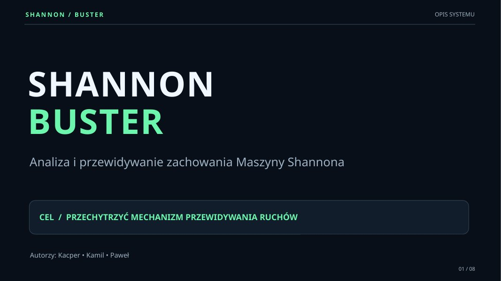
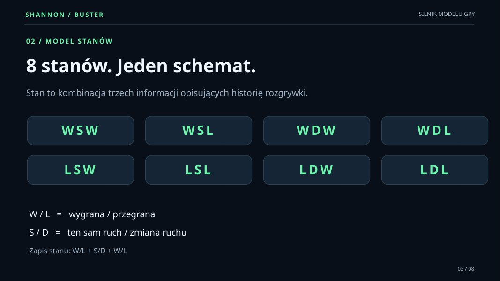
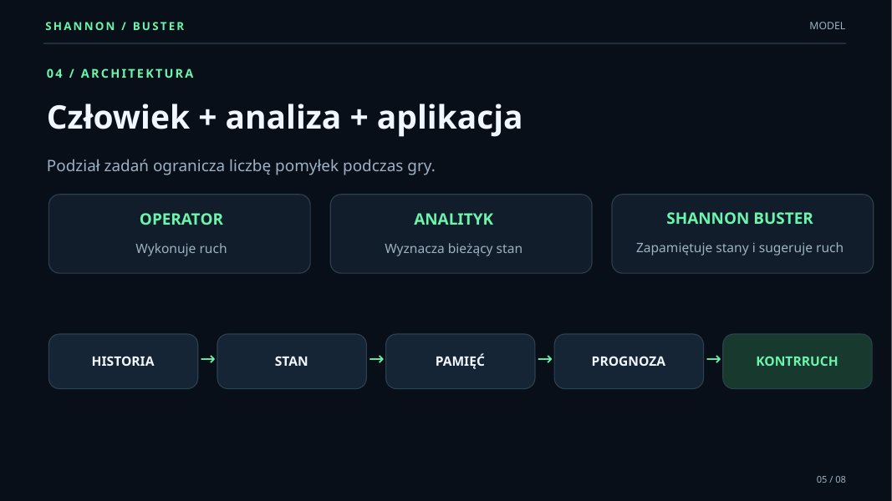
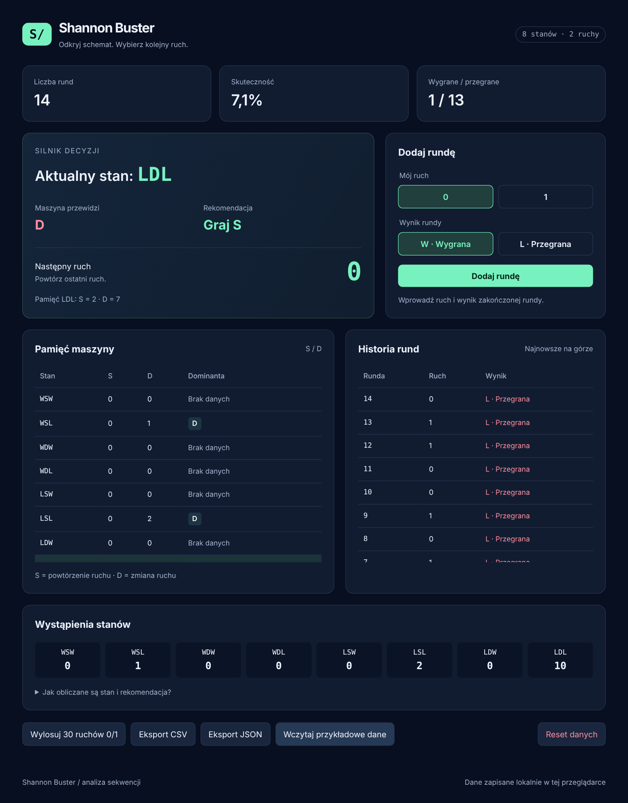

# Shannon Buster – jak przechytrzyć Maszynę Shannona

Projekt zespołowy. Analizujemy, jak działa Maszyna Shannona, czyli klasyczny automat do gry w „zgadnij 0 czy 1”, który uczy się na historii gracza i przewiduje jego następny ruch. Odtworzyliśmy jej model pamięci i zbudowaliśmy aplikację, która gra **przeciw prognozie maszyny**: liczy to samo co ona i podpowiada ruch, którego maszyna się nie spodziewa.

**Zespół:** Paweł, Kacper Książek, Kamil
**Narzędzia:** HTML, CSS, JavaScript (aplikacja w jednym pliku, bez bibliotek), projekt prezentacji

- **Aplikacja online:** [arizonu.github.io/portfolio/techniczne/shannon-buster](https://arizonu.github.io/portfolio/techniczne/shannon-buster/)
- **Prezentacja:** [shannon-buster.pdf](shannon-buster.pdf) (8 slajdów)

## Problem
Maszyna pamięta, człowiek zapomina. Maszyna Shannona dokładnie zapisuje, jak gracz zachowuje się w podobnych sytuacjach, i bezbłędnie aktualizuje te statystyki. Człowiek nie jest w stanie świadomie śledzić wszystkich swoich wzorców, a jego decyzje, nawet gdy wydają mu się losowe, bywają przewidywalne. To ciekawy przykład z pogranicza kognitywistyki i teorii informacji: ludzie są słabymi generatorami losowości.

Nasza odpowiedź: **zewnętrzna pamięć i podpowiedź decyzji**.

## Model stanów

Maszyna opisuje sytuację w grze jednym z **8 stanów**. Stan składa się z trzech informacji:

1. wynik przedostatniej rundy: **W** (wygrana) lub **L** (przegrana),
2. czy gracz potem powtórzył ruch (**S**, *same*), czy go zmienił (**D**, *different*),
3. wynik ostatniej rundy: **W** lub **L**.

Przykład: przegrana, ten sam ruch, wygrana → **LSW**. Dla każdego stanu maszyna liczy, ile razy gracz potem powtórzył ruch (S), a ile razy go zmienił (D), i przewiduje to, co zdarzało się częściej.

## Strategia
Nie gramy losowo. Gramy przeciw prognozie:

1. **Rozpoznaj stan.**
2. **Odczytaj pamięć S/D** dla tego stanu.
3. **Oszacuj prognozę** maszyny (częstsze zachowanie).
4. **Wybierz przeciwieństwo.** Jeśli maszyna spodziewa się zmiany ruchu, powtarzamy, a jeśli spodziewa się powtórzenia, zmieniamy.

Hipoteza: świadome przełamywanie przewidywań zwiększa szansę zaskoczenia maszyny.

## Architektura: człowiek + analiza + aplikacja

Podzieliliśmy zadania, żeby ograniczyć pomyłki w trakcie gry:
- **Operator** wykonuje ruch,
- **Analityk** wyznacza bieżący stan,
- **Shannon Buster** zapamiętuje stany i sugeruje ruch.

Przepływ: **historia → stan → pamięć → prognoza → kontrruch**.

## Aplikacja

Panel decyzyjny przejmuje pamiętanie i liczenie, a człowiek podejmuje ostateczny ruch.

- **Zapis rund:** ruch (0 lub 1) i wynik (W lub L).
- **Silnik decyzji:** pokazuje aktualny stan, co przewidzi maszyna, rekomendację (S lub D) i konkretny następny ruch, czyli 0 albo 1.
- **Pamięć maszyny:** tabela liczników S/D dla wszystkich 8 stanów z dominantą, a aktualny stan jest podświetlony.
- **Wystąpienia stanów** i **historia rund**.
- **Remis S = D:** brak jednoznacznych danych, więc aplikacja losuje proponowany ruch (i zapamiętuje go, żeby po odświeżeniu strony nie zmienił się).
- **Tryb „Wylosuj 30 ruchów”:** aplikacja z góry losuje sekwencję ruchów, a gracz kolejno uzupełnia wyniki. Przydaje się do porównania gry losowej z grą według rekomendacji.
- **Przykładowe dane, eksport CSV i JSON** do dalszej analizy, np. w Excelu lub Pythonie.
- Dane zapisują się lokalnie w przeglądarce (`localStorage`), a aplikacja działa też na telefonie.

Dokładna zasada liczenia jest opisana w samej aplikacji, w sekcji „Jak obliczane są stan i rekomendacja?”.

## Wnioski
1. Pamięć człowieka ma ograniczenia.
2. Narzędzie ułatwia śledzenie wzorców.
3. Model maszyny można częściowo odtworzyć.
4. Najsilniejsze połączenie to człowiek + pamięć + analiza.

> Najpierw zrozumieliśmy maszynę, potem nauczyliśmy się ją pokonywać.

Tabela pamięci w prezentacji (slajd 6) zawiera przykładowe dane demonstracyjne, a nie wyniki rzeczywistego eksperymentu.
