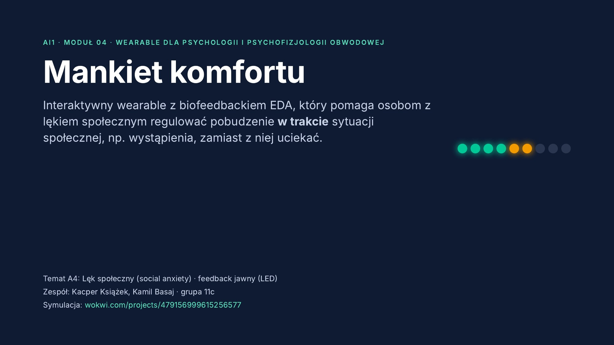
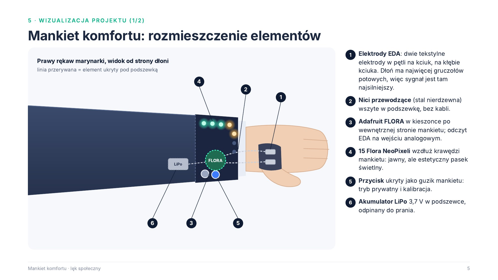
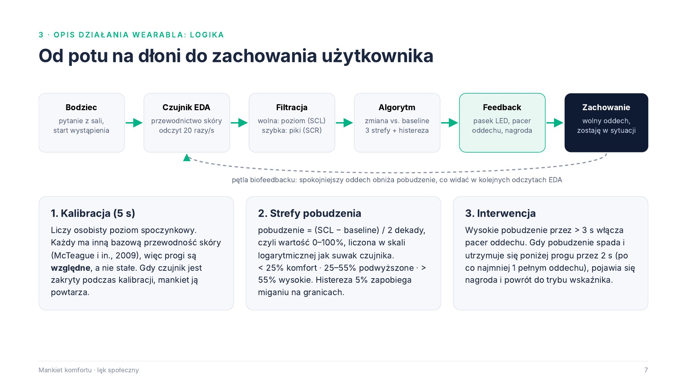
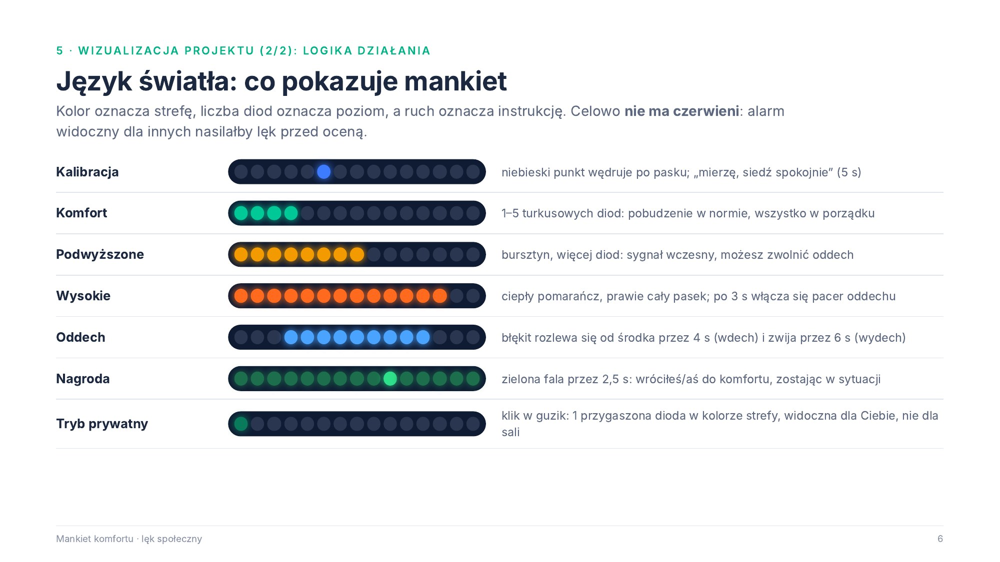
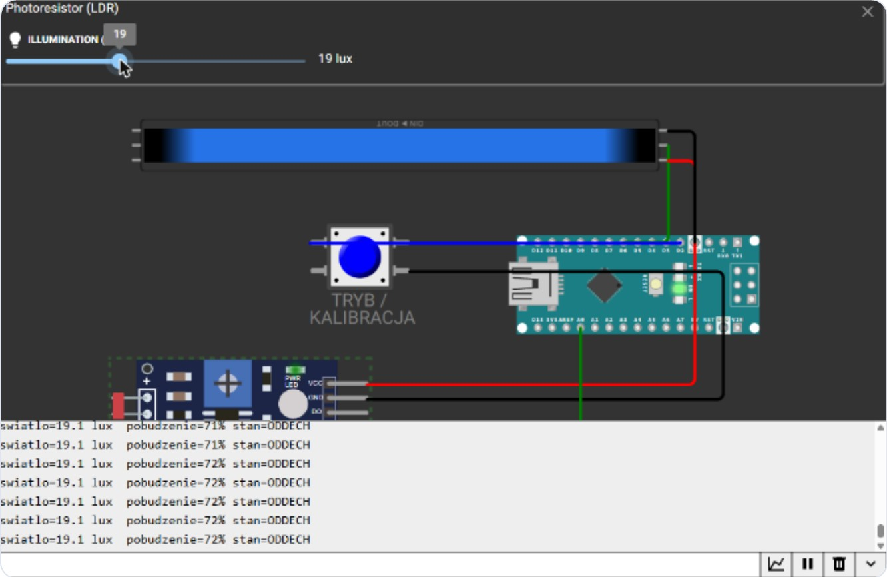

# Mankiet komfortu: wearable na lęk społeczny

Projekt zespołowy na przedmiot AI & Data Science 1 (PJATK, moduł 04: wearable dla psychologii i psychofizjologii obwodowej).

Mankiet marynarki z biofeedbackiem EDA. Pomaga osobie z lękiem społecznym regulować pobudzenie **w trakcie** sytuacji społecznej, np. wystąpienia, zamiast z niej uciekać.

**Zespół:** Kacper Książek, Kamil Basaj (grupa 11c)
**Temat:** A4, lęk społeczny, feedback jawny (LED)
**Narzędzia:** Arduino (C++), Wokwi, Adafruit FLORA i NeoPixel (projekt docelowy)

- **Symulacja:** [wokwi.com/projects/479156999615256577](https://wokwi.com/projects/479156999615256577)
- **Prezentacja:** [mankiet-komfortu.pdf](mankiet-komfortu.pdf) (13 slajdów)

## Pomysł
W lęku społecznym samo pobudzenie ciała (pot, szybkie tętno) staje się „dowodem” porażki i prowadzi do ucieczki, a ucieczka podtrzymuje lęk. Mankiet wcześnie wykrywa wzrost EDA i od razu podsuwa konkretne działanie: wolny oddech. Gdy pobudzenie spadnie, pokazuje nagrodę za to, że użytkownik **został w sytuacji**. To wspiera cel terapii ekspozycyjnej (CBT).

## Rozmieszczenie elementów

## Jak działa
**bodziec → czujnik EDA → filtracja → algorytm → feedback → zachowanie**

- **Kalibracja (5 s):** liczy osobisty poziom spoczynkowy. Progi są względne, bo każdy ma inną bazową przewodność skóry.
- **Filtracja:** wolny filtr mierzy poziom toniczny (SCL), szybki wykrywa nagłe reakcje (SCR), np. na pytanie z sali.
- **Strefy:** komfort (< 25%), podwyższone (25–55%), wysokie (> 55%). Histereza 5% zapobiega miganiu na granicach.
- **Interwencja:** wysokie pobudzenie dłużej niż 3 s włącza pacer oddechu (wdech 4 s, wydech 6 s, ok. 6 oddechów na minutę). Po uspokojeniu pojawia się zielona fala nagrody.
- **Tryb prywatny:** guzik mankietu zostawia jedną przygaszoną diodę, widoczną tylko dla użytkownika.

Celowo nie ma czerwieni: alarm widoczny dla innych nasilałby lęk przed oceną.

## Symulacja w Wokwi
| W symulacji | W prawdziwym ubraniu |
|---|---|
| Arduino Nano | Adafruit FLORA / GEMMA |
| Fotorezystor (LDR) → A0 | czujnik EDA/GSR |
| Pasek 15 LED (WS2812) → D6 | Flora NeoPixele w mankiecie |
| Przycisk → D2 | guzik mankietu |

Kod (ok. 320 linii z komentarzami) to maszyna stanów oparta na `millis()`, bez `delay()`. Ma filtry wykładnicze, detekcję SCR, przycisk z debounce i długim przytrzymaniem do rekalibracji. Pełny kod jest w symulacji.

**Jak przetestować:**
1. Ustaw suwak LDR na ok. 500 lux, kliknij ▶ Start i odczekaj 5 s kalibracji.
2. Ok. 100 lux: żółty, podwyższone pobudzenie.
3. Ok. 20 lux: pomarańcz, wysokie, a po 3 s pacer oddechu.
4. Z powrotem 500 lux: zielona fala, czyli nagroda.
5. Krótki klik w przycisk włącza tryb prywatny, przytrzymanie dłużej niż 1,5 s robi rekalibrację.

## Ograniczenia i etyka
- **Prywatność:** wszystko przetwarzane lokalnie, bez Bluetootha i chmury.
- **Błędny odczyt:** EDA rośnie też od ciepła, wysiłku czy ekscytacji. Mankiet nie diagnozuje, tylko proponuje oddech, który nie szkodzi nawet przy fałszywym alarmie.
- **Stygmatyzacja:** spokojne kolory, pasek wygląda jak ozdoba, a tryb prywatny jest pod guzikiem.
- **Zachowanie zabezpieczające:** mankiet warto stopniowo odstawiać. Wspiera terapię, ale jej nie zastępuje i nie jest wyrobem medycznym.

## Najważniejsze źródła
- [A] Wolitzky-Taylor, K. i LeBeau, R. (2023). Recent advances in the understanding and psychological treatment of social anxiety disorder. *Faculty Reviews*, 12, 8.
- [B] Alvares, G. A. i in. (2013). Reduced heart rate variability in social anxiety disorder. *PLoS ONE*, 8(7), e70468.
- Lehrer, P. M. i Gevirtz, R. (2014). Heart rate variability biofeedback: How and why does it work? *Frontiers in Psychology*, 5, 756.

Pełna bibliografia jest na ostatnim slajdzie prezentacji.
