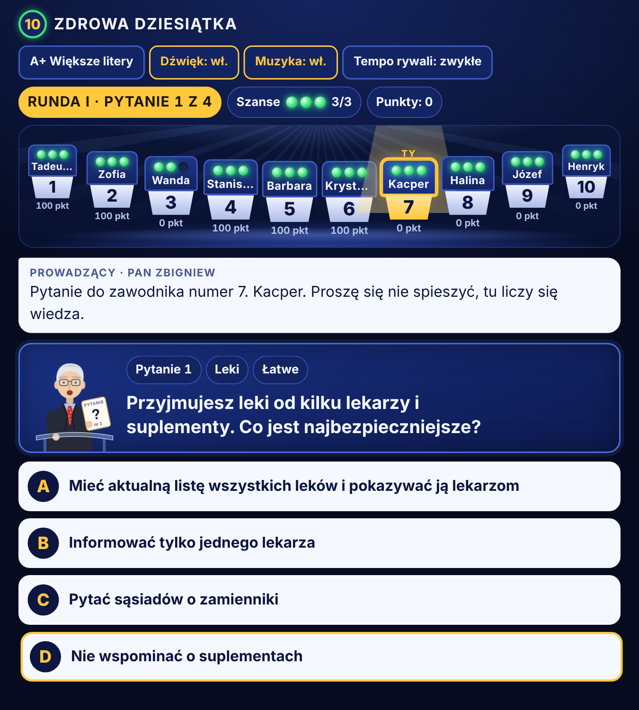
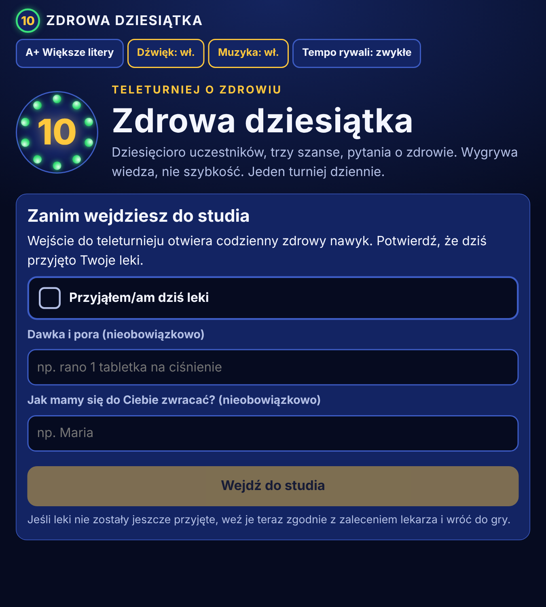

# Zdrowa dziesiątka – teleturniej o zdrowiu dla seniorów

Przeglądarkowa gra w stylu telewizyjnego teleturnieju z 10 uczestnikami i 3 szansami. Gracz odpowiada na pytania o zdrowie, leki i profilaktykę i rywalizuje z dziewięciorgiem wirtualnych seniorów. Gra jest dla osób starszych, a jej główny cel to **wzmacnianie nawyku codziennego przyjmowania leków**: wejście do studia wymaga potwierdzenia, że leki zostały dziś przyjęte, a turniej można rozegrać tylko raz dziennie.

**Typ:** gra edukacyjna (serious game)
**Narzędzia:** HTML, CSS, SVG, JavaScript, Web Audio API (bez bibliotek, jeden plik)

## Zagraj online
**[arizonu.github.io/portfolio/techniczne/zdrowa-dziesiatka](https://arizonu.github.io/portfolio/techniczne/zdrowa-dziesiatka/)**

Możesz też pobrać `index.html` i otworzyć go w przeglądarce.

## Pomysł
Wielu seniorów przyjmuje kilka leków na stałe, a pominięta dawka to częsty problem. Zamiast kolejnej przypominajki gra łączy obowiązek z czymś przyjemnym: codzienny turniej staje się „nagrodą” za przyjęcie leków. To proste zastosowanie zasad kształtowania nawyków: stały wyzwalacz (pora leków), rutyna (potwierdzenie) i nagroda (gra, punkty, seria dni).

Przy okazji gra uczy. Po każdym pytaniu prowadzący pokazuje krótką wskazówkę „Warto wiedzieć”, a na koniec gry pojawia się lista tego, czego gracz się dowiedział.

## Przebieg gry

1. **Wejście do studia.** Gracz zaznacza „Przyjąłem/am dziś leki”, może wpisać dawkę i swoje imię. Gra liczy serię kolejnych dni z potwierdzonymi lekami.
2. **Przedstawienie uczestników.** Dziewięcioro rywali z imieniem, wiekiem, miastem i krótkim opisem (np. emerytowana nauczycielka z Krakowa, pszczelarz z Białegostoku). Gracz dostaje losowe stanowisko.
3. **Runda I.** Każdy dostaje 4 pytania. Dobra odpowiedź to 100 pkt, zła gasi jedną z trzech zielonych lampek. Kto straci wszystkie lampki, odpada.
4. **Wielki finał.** Gracz i dwoje najlepszych rywali. Ocalałe lampki zamieniają się w bonus (150 pkt za każdą), pytania są trudniejsze, a dobra odpowiedź daje 200 pkt. Studio zmienia kolory na złote.
5. **Zakończenie.** Ranking, statystyki, rekord, wirtualna nagroda dla zwycięzcy (punkty × 10 zł, z wyraźną informacją, że to nie są prawdziwe pieniądze) i podsumowanie wiedzy. Następna gra jest możliwa dopiero jutro.

## Pytania
W banku jest **119 pytań** w trzech poziomach trudności, z kategorii: leki, badania, żywienie, choroby, pierwsza pomoc, profilaktyka, ruch, pamięć i codzienne zdrowie.

- 39 pytań napisanych ręcznie (np. numer 112, objawy udaru, co zrobić z przeterminowanymi lekami, sok grejpfrutowy a statyny).
- 80 pytań generowanych z tabel faktów: każdy fakt („statyny – obniżają cholesterol LDL”) daje dwa pytania, w obie strony, a błędne odpowiedzi losują się z innych faktów tej samej kategorii.
- Trudność rośnie w trakcie gry: na początku łatwe pytania, w finale średnie i trudne, a pytania nie powtarzają się w jednym turnieju.

## Projekt z myślą o seniorach
- **Czytelność:** duża czcionka Atkinson Hyperlegible (zaprojektowana dla osób słabowidzących), wysoki kontrast, przycisk „A+ Większe litery”.
- **Bez presji czasu:** gracz odpowiada w swoim tempie. Hasło gry to „wygrywa wiedza, nie szybkość”.
- **Duże cele dotykowe:** przyciski odpowiedzi mają co najmniej 66 px wysokości.
- **Regulowane tempo rywali:** wolne, zwykłe lub szybkie.
- **Dostępność:** obsługa klawiatury, widoczny fokus, opisy dla czytników ekranu (`aria-live`, `aria-pressed`, etykiety lampek), wyłączenie animacji przy ustawieniu „ogranicz ruch”.
- **Bezpieczne treści:** wskazówki odsyłają do lekarza lub farmaceuty przy zmianie dawek i nie zachęcają do samodzielnego odstawiania leków.

## Strona techniczna
- **Jeden plik, zero zależności.** Cała gra to `index.html` z wbudowanym CSS i JavaScriptem.
- **Animowany prowadzący (SVG):** pan Zbigniew mruga, porusza ustami, kiedy mówi, i macha kartą z pytaniem.
- **Muzyka i dźwięki generowane w kodzie (Web Audio API):** własne krótkie motywy w stylu teleturnieju (czołówka, start rundy, odpadnięcie, finał, fanfara z oklaskami, pożegnanie) z syntezatora, basu, perkusji i kotłów. Żadnych plików audio.
- **Studio na CSS:** łuk 10 stanowisk z lampkami, reflektor nad aktywnym graczem, konfetti na canvasie po wygranej.
- **Pamięć w przeglądarce (`localStorage`):** ustawienia, seria dni z lekami, najlepszy wynik, wirtualny skarbiec i blokada „jedna gra dziennie”.
- **Responsywność:** na telefonie stanowiska układają się w dwa rzędy po pięć.

## Testowanie
Gra pozwala na jeden turniej dziennie. Żeby zagrać ponownie tego samego dnia, otwórz adres z końcówką `#reset`:
[arizonu.github.io/portfolio/techniczne/zdrowa-dziesiatka/#reset](https://arizonu.github.io/portfolio/techniczne/zdrowa-dziesiatka/#reset)

## Uwaga
Gra ma charakter edukacyjny i nie zastępuje porady lekarza ani farmaceuty.
