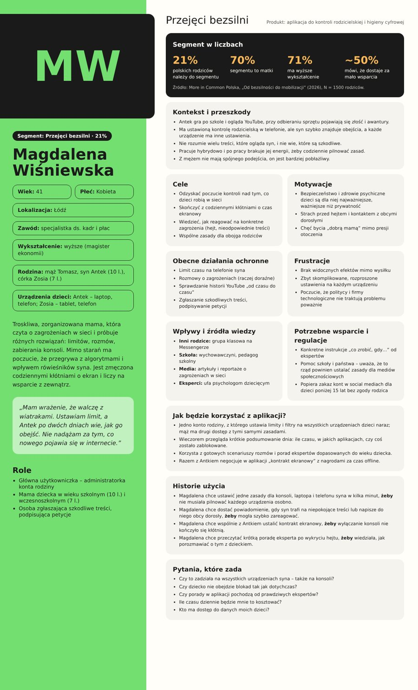
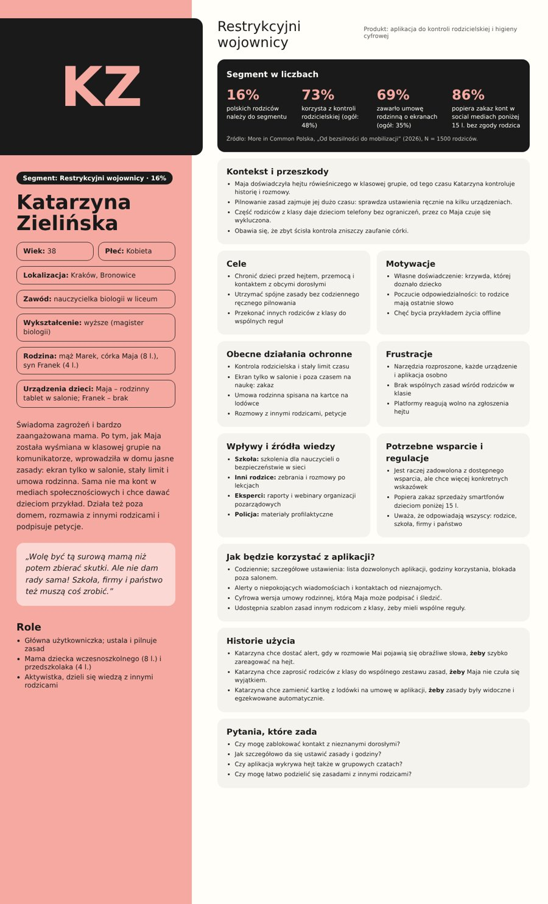
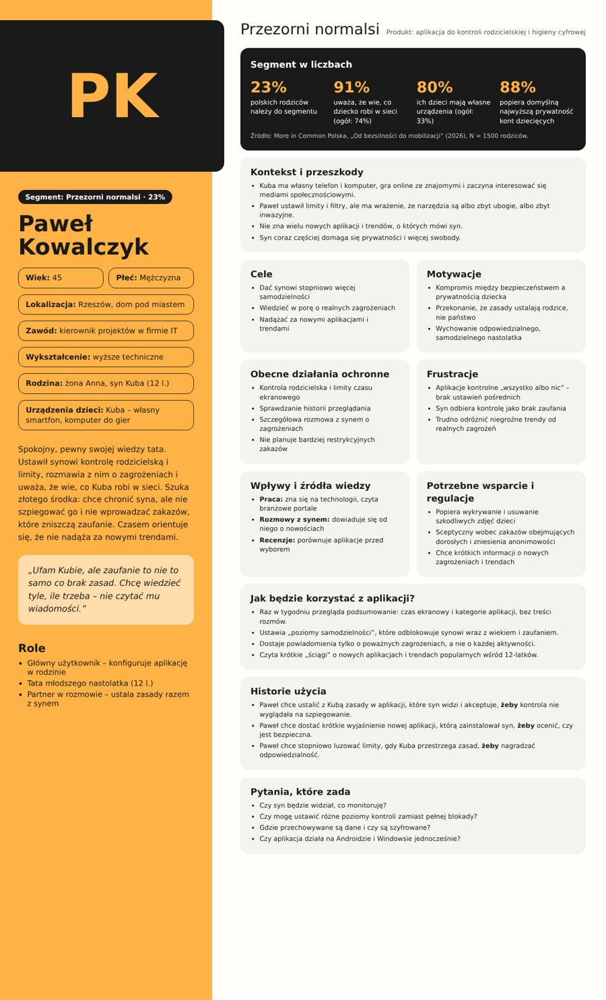
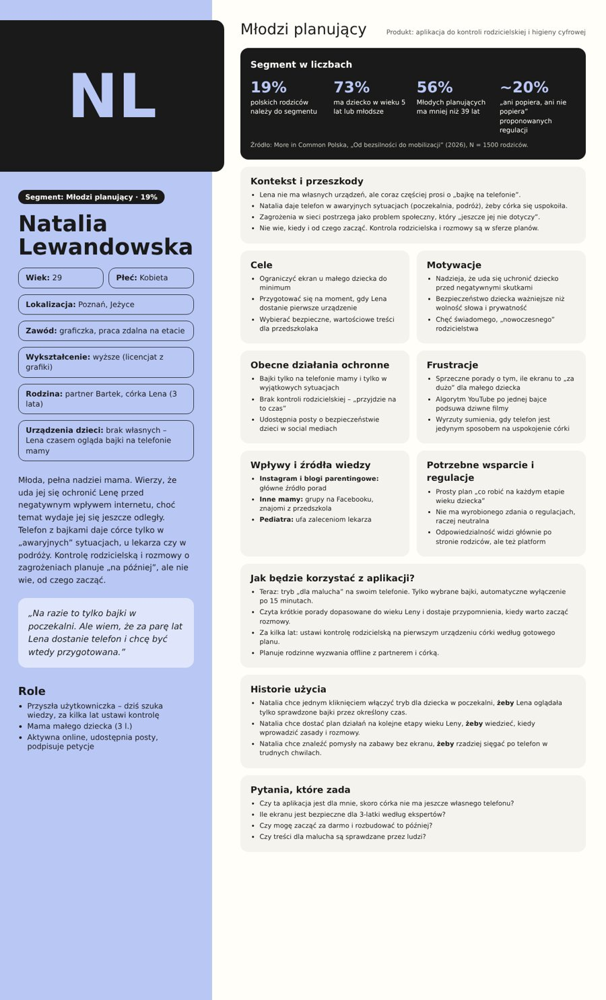

# Persony rodziców – kontrola rodzicielska

Projekt zespołowy (PJATK). Persony rodziców jako użytkowników aplikacji do kontroli rodzicielskiej i higieny cyfrowej. Każda persona opiera się na segmencie z raportu badawczego, a nie na zgadywaniu.

**Typ:** projekt zespołowy, wspólny szablon person (w stylu IxDF)
**Narzędzia:** analiza raportu badawczego, projekt person, Canva
**Plik:** [persony.pdf](persony.pdf) (4 karty)

## Źródło danych
Raport *Od bezsilności do mobilizacji* (More in Common Polska, 2026). Badanie mieszane:
- ankieta: 1500 rodziców (Ipsos, CAWI/CATI)
- 5 grup fokusowych (30 rodziców)
- analiza skupień, która dała 5 segmentów rodziców

## Persony
| Persona | Segment | Udział |
|---|---|---|
| Magdalena, 41 | Przejęci bezsilni | 21% |
| Katarzyna, 38 | Restrykcyjni wojownicy | 16% |
| Paweł, 45 | Przezorni normalsi | 23% |
| Natalia, 29 | Młodzi planujący | 19% |

Każda karta ma: dane demograficzne, opis i cytat, role, statystyki segmentu z raportu, kontekst i przeszkody, cele, motywacje, obecne działania, frustracje, źródła wiedzy, potrzebne wsparcie, sposób korzystania z aplikacji, historie użycia i pytania użytkownika.

| | |
|---|---|
|  |  |
|  |  |

Osoby na kartach są fikcyjne. W wersji oddanej na zajęcia były portrety wygenerowane przez AI. Tutaj zastępują je inicjały.
